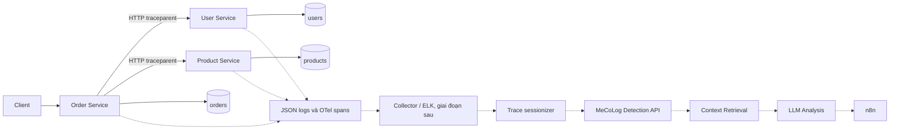

# Kiến trúc giai đoạn 1

Ba FastAPI app dùng chung một factory và lớp truy cập PostgreSQL. Compose build ba image với entrypoint riêng và ba PostgreSQL container có volume và credentials riêng. PostgreSQL tạo bảng records lúc startup; User có unique index không phân biệt hoa thường trên email. Mỗi bản ghi có UUID và payload đã kiểm tra. POST trả 201, PUT thay toàn bộ, DELETE trả 204. GET danh sách có limit/offset. GET /health đo liveness, GET /ready kiểm tra database của chính service. Port host chỉ bind loopback.

Order kiểm tra tồn tại User rồi Product bằng HTTP GET trước khi ghi Order. Timeout mỗi lần gọi và retry budget có giới hạn. Chỉ retry truy vấn GET trên lỗi kết nối, timeout hoặc 502/503/504; thiếu bản ghi trả 422. Quá budget trả 504 với timeout hoặc 502 với lỗi dependency. Kiểm tra tham chiếu và ghi Order là hai bước riêng. Một User/Product có thể bị xóa sau khi đã kiểm tra; ứng dụng không cung cấp transaction hoặc foreign key xuyên service.

Incoming HTTP dùng W3C Trace Context để extract. Order tạo CLIENT span riêng từng lần gọi rồi inject traceparent/tracestate. User và Product tạo SERVER span mới dưới CLIENT span tương ứng. Response mang x-trace-id để tra cứu. Log JSON có thời điểm UTC, service, event, trace_id, span_id và dữ liệu vận hành có cấu trúc. Route log là route template; body, email, UUID trong URL và ground truth không được ghi. Compose xuất JSON span ra stdout với OpenTelemetry ConsoleSpanExporter. App logs qua stderr. Collector/ELK và OTLP backend thuộc giai đoạn sau. [OpenTelemetry propagation](https://opentelemetry.io/docs/languages/python/propagation/)

## Hợp đồng collector → detection

app/contracts.py định nghĩa DetectionSession v1 gồm session_id, trace_id, service_name, start_time, end_time, events và source_metadata. service_name cấp session là service gốc, còn mỗi event giữ service phát log. Event có ID ổn định, thời gian có timezone, level, tên event, thông điệp đã xử lý dữ liệu nhạy cảm và span ID khi có. Metadata khai báo collector, environment, phiên bản sessionization, completeness và dropped_events. Schema từ chối field lạ. Collector phải lọc nhãn kịch bản cả trong field và nội dung message. Ground truth và trace_id dùng để đối chiếu trong bộ đánh giá ngoại tuyến, bên ngoài luồng mô hình.

- **HDFS** gom theo BlockId, một thực thể bền qua nhiều log line. **BGL** cắt theo số dòng, window/stride 20, không bảo đảm chung request. **Microservices** gom theo trace ID, có nhiều nhánh và retry. Cần dedup bằng event ID, sắp theo timestamp UTC với tie-break xác định, chờ late events theo deadline và đánh dấu trace thiếu. Với thứ tự nhân quả, ưu tiên span parent/link khi có; timestamp có thể lệch giữa service.
- **Unseen templates và OOV.** Ưu tiên event_name/route ổn định từ structured log. Khi dùng Drain, fit cây từ tập development được duyệt, freeze khi đánh giá và ghi tỷ lệ fallback/unseen. Tham số chưa thấy chuyển về UNK theo vocabulary frozen. Không cho trace ID, UUID ngẫu nhiên hoặc token nhạy cảm trở thành template hoặc feature định danh.
- **Padding và độ dài.** Giữ true length trong contract và báo padding/truncation. Cần chốt cách cắt trace dài và ranh giới window trước khi so sánh, vì encoder gốc có thể nhạy với padding. Phân tích riêng trace ngắn, dài, thiếu hoặc nhiều retry. Contract nhận tối đa 2.048 event; đây là giới hạn vận chuyển, khác window của encoder.
- **Support set.** Chọn trace Normal/Anomaly có nhãn lab hoặc chuyên gia từ tập support riêng, bao phủ topology và loại lỗi. Khóa query trước đánh giá. Ranh giới 4 event từ HDFS chưa được xác nhận cho trace microservices. Đánh giá domain shift, prevalence tự nhiên, FPR, độ bao phủ và drift trước khi đưa score vào workflow.
- **Các giai đoạn sau.** Detection trả session_id, model/prototype revision, anomaly score, threshold và nhãn; Context Retrieval trả bằng chứng theo trace và thời gian; LLM nhận bằng chứng đã lọc và sinh phân tích có dẫn chiếu; n8n tiêu thụ sự kiện có idempotency key. Các dịch vụ này hiện chỉ có thiết kế contract, không có endpoint giả.
