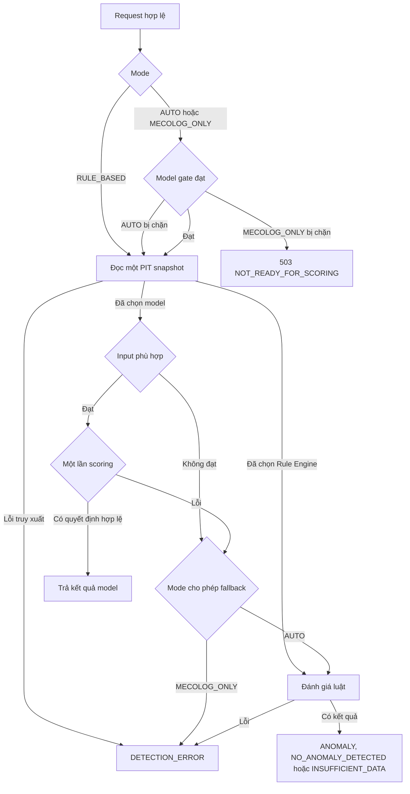

# Stage 9.2 — Hybrid Detection Router

`POST /detect/hybrid` điều phối Rule Engine 1.0.0 và một interface chấm điểm theo snapshot. FastAPI xác thực request, áp hạn 10 giây cho response và ghi log JSON với mã chẩn đoán cố định. Router dùng một `ContextStore.snapshot` cho mỗi trace cần đọc. PIT giữ nhất quán giữa các trang, dùng `search_after` và đóng bằng PIT ID mới nhất trong `finally`. Nếu response đã hết hạn khi Elasticsearch I/O đang chạy, worker có thể tiếp tục đến khi I/O trả về rồi đóng PIT. HTTP client có timeout I/O riêng và PIT có thời hạn tự hết.

## Quyết định routing

| Mode | Gate hoặc kết quả | Hành vi |
| --- | --- | --- |
| `AUTO` mặc định | Domain chưa được xác minh hoặc thiếu điều kiện scoring | Chọn Rule Engine và công bố lý do fallback. Production hiện trả `DOMAIN_NOT_VALIDATED`. |
| `AUTO` | Gate và input đạt, model thực thi thành công | Dùng kết quả model, kể cả kết quả không có anomaly. |
| `AUTO` | Input không tương thích, model unavailable, timeout hoặc lỗi thực thi | Dùng Rule Engine trên cùng snapshot. Không chạy lại model. |
| `RULE_BASED` | Mọi request hợp lệ | Chỉ dùng Rule Engine. `fallback_used=false`, `model_readiness=null`. |
| `MECOLOG_ONLY` | Gate chưa đạt | HTTP 503, `error.code=NOT_READY_FOR_SCORING`, trước khi truy xuất log. |
| `MECOLOG_ONLY` | Gate đạt | Chỉ thực hiện scoring nếu input đạt. Input không phù hợp trả 422, lỗi runtime hoặc execution trả 503, timeout trả 504. |



## Readiness, compatibility và fallback

Các điều kiện được biểu diễn riêng gồm checkpoint, runtime, configuration, input, domain validation và approved scoring runtime. `null` nghĩa là chưa đánh giá. Production chưa có approved snapshot adapter và chưa xác minh domain Microservices, nên Router không load checkpoint, không kiểm tensor hay gọi model forward khi nhận request. Không có biến môi trường để mở gate. `PreparedScoring.detect(session)` yêu cầu `DetectionSession` hoàn chỉnh và kiểm support/query overlap. PIT của Rule Engine chưa chứng minh completeness và chưa có adapter đã duyệt để chuyển thành input cho scorer đó. `FrozenEncoder` kiểm hình dạng và kiểu tensor, là một kiểm tra riêng với domain validation.

Interface model-ready được kiểm bằng dependency injection ở unit test. Adapter chỉ nhận các event đã chuẩn hóa từ cùng PIT, không nhận metadata ngoài allowlist. Output phải có boolean quyết định, score hữu hạn và evidence IDs thuộc các event hợp lệ. Kết quả của test double chỉ kiểm chứng routing.

Các lý do AUTO gồm `DOMAIN_NOT_VALIDATED`, `MODEL_NOT_READY`, `MODEL_RUNTIME_UNAVAILABLE`, `INPUT_INCOMPATIBLE`, `MODEL_TIMEOUT` và `MODEL_EXECUTION_ERROR`. `fallback_used` cho biết đã chọn đường fallback. Nếu truy xuất log thất bại trước khi chạy engine, `executed_mode=null` và `detection_source=none`. Rule Engine lỗi trả `DETECTION_ERROR`; kết quả thiếu bằng chứng trả `INSUFFICIENT_DATA`. Cả hai có `is_anomaly=null`. Router giữ score của Rule Engine bằng `null`, giữ nguyên severity, evidence và `partial/unknown`.

`GET /health` vẫn đo liveness. `GET /ready` giữ contract MeCoLog cũ. `GET /detect/capabilities` báo mode và version, Rule-based/AUTO availability dựa trên cấu hình store, cùng gate MeCoLog của Hybrid. Capability chỉ xác nhận khả năng định tuyến, không gửi probe Elasticsearch. `POST /detect/rule-based`, `/detect/trace` và `/detect/session` giữ behavior Stage 9.1.

## API

```json
{"trace_id":"aaaaaaaaaaaaaaaaaaaaaaaaaaaaaaaa","mode":"AUTO"}
```

Trích response HTTP 200 thu được qua FastAPI TestClient với HTTP 503 completion trong Elasticsearch mock transport.

```json
{
  "requested_mode":"AUTO",
  "executed_mode":"RULE_BASED",
  "detection_source":"rule_based",
  "detection_status":"ANOMALY",
  "is_anomaly":true,
  "fallback_used":true,
  "fallback_reason":"DOMAIN_NOT_VALIDATED",
  "model_score":null,
  "rule_version":"1.0.0",
  "router_version":"1.0.0",
  "context_completeness":"partial",
  "evidence_event_ids":["00000000000000000000000000000005"]
}
```

Request cùng trace với mode `MECOLOG_ONLY` trả HTTP 503 với `error.code=NOT_READY_FOR_SCORING`, `fallback_used=false` và `executed_mode=null`. Payload không hợp lệ trả 422. Lỗi Rule Engine trả 500. ES response sai trả 502, store unavailable trả 503, timeout hoặc search không hoàn chỉnh trả 504. Schema đầy đủ có tại `/docs`.

## Chạy và kiểm thử

Từ worktree `thesis-log-anomaly-stage91` trong PowerShell.

```powershell
$python = "..\thesis-log-anomaly\.venv\Scripts\python.exe"
& $python -B -m tools.check_stage_9_1_integrity
& $python -B -m pytest -q -p no:cacheprovider tests/test_hybrid_detection.py tests/test_hybrid_api.py tests/test_rule_detection.py tests/test_detection.py tests/test_context.py tests/test_api.py tests/test_contract.py tests/test_logging_file.py tests/test_integration.py
```

Cấp `DETECTION_ES_URL` và `DETECTION_ES_API_KEY` cho một Elasticsearch cô lập, rồi chạy trên cổng loopback riêng.

```powershell
& $python -m uvicorn app.detection_api:app --host 127.0.0.1 --port 18014 --no-access-log
# Trong một PowerShell khác
Invoke-RestMethod -Method Post -Uri 'http://127.0.0.1:18014/detect/hybrid' -ContentType 'application/json' -Body '{"trace_id":"aaaaaaaaaaaaaaaaaaaaaaaaaaaaaaaa","mode":"AUTO"}'
```

Kiểm thử gồm 25 unit PASS, 10 API integration PASS và 62 Stage 9.1 regression PASS. 10 PostgreSQL integration SKIP vì không cấp isolated DB. Docker Compose `config --quiet` qua, còn build image và live Docker/Elasticsearch là `NOT_TESTED_LIVE`. Không có Gemini calls, OpenAI calls hoặc live fault injection. Scoped integrity PASS. Full benchmark vẫn báo sai hai digest LLM và historical 88/88 vẫn `HISTORICAL_SCOPE_UNRESOLVED`.

## Bàn giao Monitoring Worker

Worker có thể kiểm tra capabilities rồi gọi Hybrid bằng AUTO và lưu `detection_id`, `trace_id`, quyết định, nguồn, lý do fallback, evidence IDs, completeness và version. Đề xuất xem xét incident khi có ảnh hưởng outcome đã quan sát như request cuối trả 5xx cùng bằng chứng phù hợp, hoặc khi có chuỗi R07 đủ liên kết. Timeout retry đã phục hồi vẫn là tín hiệu telemetry. Thêm chính sách incident riêng trước khi dùng trạng thái đó để mở sự cố. Giữ `INSUFFICIENT_DATA` và `DETECTION_ERROR` làm trạng thái riêng, không nâng completeness, và không dùng tên luật để suy ra root cause. Stage 9.2 chỉ trả kết quả detection.
