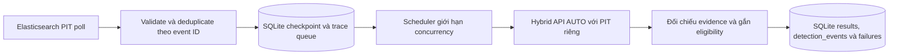
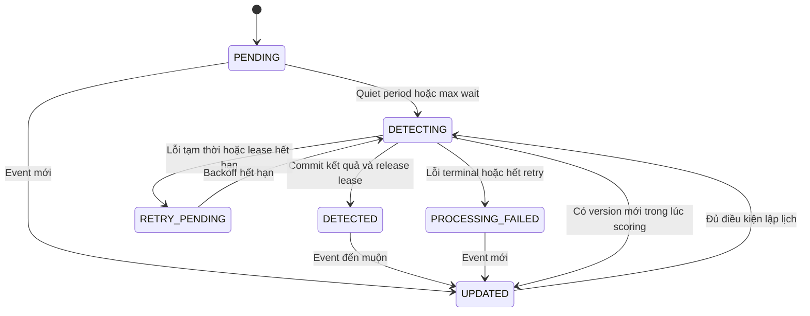

# Stage 9.3 — Automatic log monitoring

Worker chạy độc lập, dùng Elasticsearch để phát hiện trace có log mới và gọi `POST /detect/hybrid` với mode `AUTO`. SQLite riêng lưu checkpoint, producer events, trace queue, kết quả và lỗi. Rollout yêu cầu bật cấu hình. Worker mặc định disabled.



## Mapping và polling

| Field | Nguồn và cách dùng |
| --- | --- |
| `event_id`, `trace_id` | UUID producer và trace ID OpenTelemetry. Event ID là khóa dedup, trace ID là khóa aggregation. |
| `@timestamp` | Pipeline lấy từ `app.timestamp`. Elasticsearch mapping là `date_nanos`; producer hiện ghi UTC tới microsecond. Đây là cursor thời gian. |
| `service_name`, `span_id`, `request_id` | Field producer được ingest. Request ID cho phép đối chiếu recovery cùng request. |
| `message`, `level`, `status_code` | Event type chuẩn hóa, mức log và mã status nếu có. |
| `error_type`, `dependency_service`, `endpoint`, `http_method` | Field telemetry bổ sung trong allowlist. Worker không áp lại các luật detection. |
| `_id`, `_index` | Elasticsearch hit metadata. Filebeat lấy `_id` từ `app.event_id`. Worker dedup theo producer field và không dùng hit metadata thay cho ID bị thiếu. |
| Ingestion timestamp, parent span ID | Chưa có field đáng tin cậy trong mapping hiện tại. Không dùng làm cursor hoặc bằng chứng. |

Mỗi poll cố định cửa sổ `[max(initial_floor, previous_watermark - overlap), poll_start)`. Query dùng PIT, sort `@timestamp, event_id, _shard_doc` và phân trang bằng `search_after`. `_shard_doc` chỉ có nghĩa bên trong PIT. Worker giới hạn thời gian và số page, kiểm tra partial/shard failure, rồi đóng PIT ID mới nhất. Cleanup có deadline riêng hai giây. PIT có TTL nếu thao tác đóng không thành công.

SQLite lưu checkpoint ID, index scope, worker version, fingerprint, initial floor, high watermark, producer tiebreaker chẩn đoán, event ID hợp lệ cuối, last successful poll và updated time. Mỗi page commit event và trace queue trong một transaction. Watermark compare-and-set chỉ tiến sau khi toàn bộ cửa sổ được đọc. Crash trước commit cho phép đọc lại page. Crash sau commit page nhưng trước watermark cho phép replay với dedup. PIT ID và shard cursor không được ghi vào checkpoint.

`START_FROM_NOW` lấy thời điểm khởi tạo làm floor; mọi lần chạy sau tự resume checkpoint đã có. `EXPLICIT_LOOKBACK` yêu cầu 1–86400 giây và chỉ áp dụng khi khởi tạo DB. `RESUME_CHECKPOINT` yêu cầu checkpoint có sẵn. Fingerprint ràng buộc version, ES origin, index scope, overlap và Detection origin. Thay đổi tham số fingerprint, checkpoint lỗi hoặc clock lùi dẫn đến dừng có mã lỗi. Vận hành với một worker trên mỗi SQLite database. Cấu hình polling hoặc tuning không dùng credentials trong fingerprint.

## Dedup và lifecycle



Producer ID trùng cùng payload chuẩn hóa chỉ tăng counter. Nếu ID trùng nhưng payload khác, bản đầu được giữ với cờ conflict, trace của bản đầu được đánh dấu update và bằng chứng dùng ID đó phải được rà soát. Event thiếu trace được đếm uncorrelated. Event thiếu ID hoặc invalid bị loại. Không sinh producer ID. Các field ngoài allowlist không được lưu.

Quiet period tính theo thời gian worker thấy event cuối, max wait tính theo lần chờ của nhóm event hiện tại. Cả hai là điều kiện lập lịch, không xác nhận trace complete. Scheduler claim qua SQLite transaction, có token để từ chối kết quả từ claim cũ và lease để khôi phục sau crash. Nếu event đến khi vẫn đang detection, kết quả của version đã claim được lưu và version mới tiếp tục chờ. Retry dùng exponential backoff có giới hạn. Timeout hoặc transport failure dùng cooldown tối thiểu mặc định 90 giây sau lỗi. Client giới hạn concurrency, connect/read timeout và overall deadline. Cooldown giảm nguy cơ request cùng trace chồng lên I/O còn chạy phía server. Worker không có xác nhận server-side cancellation.

Dedup, kết quả và lỗi của trace terminal được dọn theo trace retention, chỉ khi mọi event đã ra ngoài vùng overlap. Pending/lease được giữ. Log đến muộn trong overlap được thấy ở poll kế tiếp và tăng trace version nếu là ID mới. Event cũ hơn vùng overlap, cũ hơn initial floor hoặc đã bị index retention xóa có thể bị bỏ lỡ. Khi cửa sổ vượt page budget, worker giữ watermark và báo degraded. Kiểm tra lượng ingest và điều chỉnh page budget trước khi tiếp tục với checkpoint hiện có.

## Detection Event và bàn giao Stage 9.4

Hybrid dùng PIT khác với worker. Kết quả tách `worker_observed_event_ids` và services tại lúc claim khỏi `evidence_event_ids` và services của API. Field `unobserved_evidence_event_ids` chỉ ra evidence Hybrid đã thấy nhưng worker chưa poll. `conflicting_evidence_event_ids` giữ dấu hiệu ID tranh chấp. Không tạo snapshot hash. Trace `DETECTED` nghĩa là đã lưu đánh giá cho version, còn `context_completeness` giữ nguyên từ API và không suy ra coverage toàn trace.

JSON trong `results.document` giữ toàn bộ Hybrid result, bổ sung `detection_event_id`, `idempotency_key`, `trace_version`, worker-observed IDs/services, các ID chưa đối chiếu hoặc conflict, `incident_eligibility`, `eligibility_reason`, `detected_at` và `persisted_at`. Kết quả ANOMALY đọc từ view `detection_events`. Các kết quả `NO_ANOMALY_DETECTED` và `INSUFFICIENT_DATA` vẫn ở `results`. Lỗi lưu ở `failures` với mã đã sanitize, kèm kết quả Hybrid đã validate nếu có. `is_anomaly` giữ `null` khi thiếu bằng chứng hoặc lỗi; score Rule-based luôn `null`.

| Eligibility | Điều kiện |
| --- | --- |
| `ELIGIBLE` | R01 có evidence nằm trong quan sát của worker và xác nhận completion HTTP 5xx. |
| `RECOVERED_SIGNAL` | Chỉ khớp R02 và mỗi retry timeout có completion 2xx xảy ra sau đó trên cùng service và request ID. |
| `NEEDS_MORE_EVIDENCE` | Insufficient, evidence chưa poll hoặc conflict, hoặc tín hiệu chưa có ảnh hưởng request xác nhận. Bao gồm cascade hay lỗi repository/processing khi thiếu outcome phù hợp. |
| `NOT_ELIGIBLE` | Không phát hiện anomaly. |

Stage 9.4 có thể đọc view và dùng `idempotency_key` chống xử lý lặp cùng version. Dùng `trace_id` và version để nhóm các đánh giá của cùng trace khi thiết kế incident identity. R07 là tín hiệu lan truyền và completeness thấp vẫn được giữ. Worker không gửi notification, tạo incident hoặc gọi LLM. Delivery từ worker tới Hybrid có thể lặp sau crash; SQLite lưu idempotent theo cặp trace/version trong thời gian retention. Đây là cơ chế at-least-once với lưu trữ idempotent, không bảo đảm exactly-once toàn hệ thống.

## Cấu hình và vận hành

Tất cả cấu hình có prefix `MONITORING_`. Default standalone không có URL hoặc key; overlay Docker dùng tên service nội bộ và profile `monitoring`.

| Biến sau prefix | Mặc định |
| --- | --- |
| `ENABLED`, `DRY_RUN` | `false`, `false` |
| `ES_URL`, `ES_API_KEY`, `DETECTION_URL` | Cấp qua môi trường với stack cô lập |
| `ES_INDEX`, `STORAGE_PATH` | `thesis-logs-*`, `monitoring.sqlite`. Docker dùng `/data/monitoring.sqlite`. |
| `START_POLICY`, `LOOKBACK_SECONDS`, `OVERLAP_SECONDS` | `START_FROM_NOW`, 0, 300 |
| `POLL_INTERVAL_SECONDS`, `BATCH_SIZE`, `MAX_PAGES`, `POLL_TIMEOUT_SECONDS` | 5, 128, 32, 15 |
| `QUIET_PERIOD_SECONDS`, `MAX_TRACE_WAIT_SECONDS`, `MAX_CONCURRENT_TRACES` | 5, 30, 2 |
| `DETECTION_TIMEOUT_SECONDS`, `MAX_RETRIES`, `RETRY_BACKOFF_SECONDS`, `TIMEOUT_COOLDOWN_SECONDS` | 12, 2, 10, 90 |
| `RETENTION_SECONDS` | 604800 |

Dry-run có bật thực hiện một truy vấn ES giới hạn, báo số hit và đóng PIT. Nó xem trước lookback đã cấu hình hoặc overlap mặc định, không đọc hoặc ghi checkpoint/SQLite và không gọi Detection API. Disabled không mở client hay database.

`--status` đọc SQLite chỉ đọc, báo ready sau poll thành công, degraded khi backend lỗi hoặc heartbeat quá hạn, và phân biệt disabled, stopped, failed. Detection health được cập nhật qua kết quả gọi thật, không probe khi không có trace. Status có checkpoint times, queue, in-flight, event counts, conflicts, late events, retries, outcome counts và tổng latency. SIGINT/SIGTERM dừng nhận page mới và dừng lập lịch mới; worker chờ request hiện tại theo deadline, đóng PIT và clients. Trường hợp bị giết giữa chừng được xử lý bằng durable pages và lease expiry.

Nếu checkpoint hỏng, giữ DB, WAL và SHM, dừng worker và khôi phục từ SQLite backup đã xác minh. Nếu đổi nguồn hoặc cần khởi tạo lại theo operator decision, cấu hình DB riêng và start policy giới hạn. Worker không tự reset checkpoint.

```powershell
$python = "..\thesis-log-anomaly\.venv\Scripts\python.exe"
& $python -B -m tools.check_stage_9_1_integrity
& $python -B -m app.monitoring_worker --status
# Cấp MONITORING_ES_URL, MONITORING_ES_API_KEY và MONITORING_DETECTION_URL
# từ môi trường Elasticsearch/Hybrid cô lập trước khi bật.
$env:MONITORING_ENABLED = "true"
$workerState = Join-Path $env:LOCALAPPDATA "MeCoLog\stage93-isolated"
New-Item -ItemType Directory -Force $workerState | Out-Null
$env:MONITORING_STORAGE_PATH = Join-Path $workerState "monitoring.sqlite"
& $python -B -m app.monitoring_worker
```

Kiểm thử offline không cần Docker hoặc PostgreSQL:

```powershell
& $python -B -m pytest -q -p no:cacheprovider tests/test_monitoring_store.py tests/test_monitoring_worker.py tests/test_monitoring_integration.py
```

Kết quả thực thi gồm 48 monitoring unit PASS, 1 pipeline integration PASS và 97 regression PASS cho Rule Engine, Hybrid, Detection, Context, API contracts và logging. 10 PostgreSQL integration SKIP do không cấp `TEST_PG_ADMIN_URL`. Tổng 146 PASS, 0 FAIL, 10 SKIP, một cảnh báo deprecation từ Starlette. Scoped integrity PASS. Full LLM benchmark vẫn dừng tại hai digest đã ghi nhận và historical 88/88 giữ `HISTORICAL_SCOPE_UNRESOLVED`. Gemini, OpenAI và live fault injection đều bằng 0.

Compose overlay dùng project-scoped volume và network, không publish port. Kiểm tra cấu hình bằng `docker compose -p thesis-stage93-config --profile monitoring -f compose.yaml -f compose.logging.yaml -f compose.detection.yaml -f compose.monitoring.yaml config --quiet` với biến nội suy fixture hoặc cấu hình cô lập. Lượt kiểm tra không khởi động stack. Image build và Docker/Elasticsearch live là `NOT_TESTED_LIVE`.
