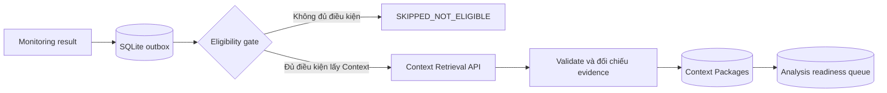
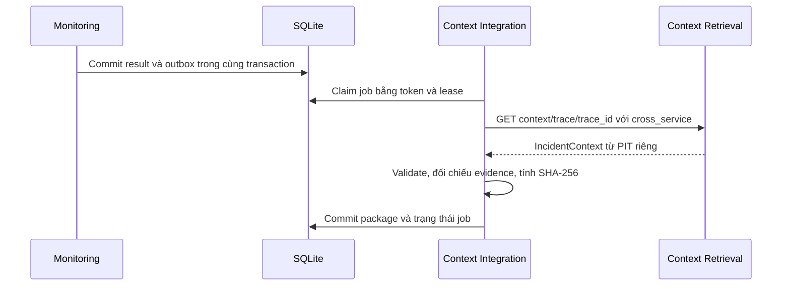
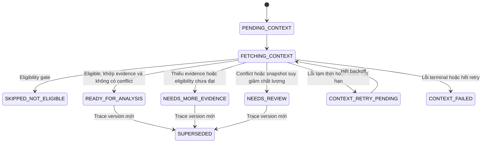

# Stage 9.4 — Automatic context integration

Context Integration là worker độc lập. Nó nhận kết quả Monitoring đã commit, gọi Context Retrieval API hiện có, đối chiếu bằng chứng rồi lưu Context Package trong cùng SQLite của stack cô lập. Các lần gọi Context chậm không chặn vòng polling hoặc Hybrid Detection. Worker mặc định tắt.





## Consumption, eligibility và readiness

Migration tạo các đối tượng `context_settings`, `context_jobs`, `context_packages`, `context_attempts`, `context_status`, `context_counters`, view `analysis_readiness_queue` và trigger `enqueue_context_result`. Trigger enqueue ngay trong transaction chèn vào `results`; `detection_events` của Stage 9.3 vẫn giữ là view anomaly. Trigger chỉ bắt INSERT sau khi cài migration, kể cả INSERT khi Context Integration tạm dừng. Startup không đọc lại historical results. Job giữ bản Detection Event để chờ xử lý độc lập với retention của stage nguồn. Detection failures của Stage 9.3 vẫn nằm trong bảng `failures`.

| Detection | Hành vi |
| --- | --- |
| `ANOMALY + ELIGIBLE` | Lấy Context và có thể vào analysis queue sau khi đối chiếu. |
| `ANOMALY + NEEDS_MORE_EVIDENCE` | Lấy Context và lưu package để bổ sung bằng chứng. Duy trì `NEEDS_MORE_EVIDENCE` cho tới khi upstream cung cấp eligibility phù hợp ở trace version mới. |
| `RECOVERED_SIGNAL`, `NOT_ELIGIBLE`, hoặc kết quả non-anomaly | Lưu lý do skip, giữ kết quả nguồn. |
| `INSUFFICIENT_DATA` hoặc `DETECTION_ERROR` | Không truy xuất Context tự động. Giữ trạng thái thiếu dữ liệu hoặc lỗi ở dữ liệu nguồn và chờ upstream đánh giá lại. |



`READY_FOR_ANALYSIS` yêu cầu package đã commit và evidence khớp với Detection Event đủ eligibility. PARTIAL hoặc UNKNOWN vẫn được bảo toàn và được phép vào queue nếu evidence đã đủ cho phân tích có giới hạn; lý do readiness ghi nhận giới hạn này. Context báo conflict, truncated search, timeout hoặc invalid documents sẽ chặn readiness. Analysis contract downstream cần hỗ trợ abstention. Worker không xác nhận root cause hoặc tạo incident.

## API, evidence và privacy

Request thực tế là `GET /context/trace/{trace_id}?mode=cross_service&wait_ms=0`. Response là `IncidentContext` của API v1. Endpoint Context hiện không đòi auth từ client. ES API key thuộc Context Service và không được chuyển qua worker này. Bản v1 không cung cấp PIT ID, reference hay receipt proof. Endpoint v2 có completeness provenance riêng và không được dùng trong stage này. Worker bảo toàn COMPLETE, PARTIAL hoặc UNKNOWN do endpoint đã chọn trả về. Số lượng service do context quan sát quyết định.

Schema xác thực trace/mode, timestamps UTC-aware, service, event identity, timeline và dependency references. Wire event trùng bị từ chối và có mã riêng cho bản trùng mâu thuẫn. Nếu Context Service đã lọc ID mâu thuẫn và chỉ báo count, package ghi count cùng trạng thái conflict, không suy ra ID. Worker giữ riêng monitoring-observed IDs, detection evidence IDs và context event IDs. Khi còn bản quan sát SQLite cho cùng evidence ID, worker so sánh các field chung để nhận ra thay đổi giữa hai snapshot. Reconciliation trả `MATCHED`, `PARTIAL_MATCH`, `MISSING_EVIDENCE` hoặc `CONFLICTING_EVIDENCE`. Additional events không sửa Detection Event hay tăng trace version.

Chỉ nhận event names, error codes, quality keys, warning codes và nested fields nằm trong allowlist của Context Service. Bất kỳ field lạ, credential-bearing content, ground truth hoặc activation metadata trong payload đều bị từ chối theo contract. HTTP body lỗi và exception raw không được ghi vào SQLite hoặc log. Payload vượt giới hạn bị từ chối. Chính sách áp dụng cho structured evidence của schema v1; thay đổi contract cần kiểm lại allowlist. Worker không sửa raw log hoặc artifact nghiên cứu.

## Persistence, retry và bàn giao Stage 9.5

Package giữ version và identity của Detection Event, metadata routing, trace và correlation key, policy eligibility, các tập evidence, completeness, Context JSON, hash, thời điểm detection/retrieval/persistence, readiness và retry metadata. `context_payload_sha256` là hash của Context JSON đã validate và serialize lại bằng UTF-8, key sắp xếp, separator gọn, giữ thứ tự array. Đây là hash payload đã lưu. `read_ready(package_id)` đọc qua view readiness và kiểm lại hash/schema trước khi bàn giao; `read_package` phục vụ đọc lịch sử.

Package identity dựa trên detection event và processing version. Cặp trace/version của Stage 9.3 không thay đổi. Hash namespace và trace ID là khóa gợi ý correlation với scope một nguồn Monitoring, không phải quy tắc incident identity tổng quát. Trace version mới loại package cũ chưa được phân tích khỏi view readiness bằng trạng thái job `SUPERSEDED`; tài liệu package cũ vẫn bất biến và version mới có `supersedes_package_id` khi có predecessor. Các job terminal được giữ theo retention sau khi bản ghi nguồn hết retention. Job chưa hoàn thành vẫn được giữ.

Lease giới hạn claims đồng thời và chỉ cho một context job đang chạy trên cùng trace. Package, attempt và trạng thái commit cùng nhau. Nếu tiến trình chết trước commit, lease hết hạn và job có thể retry. Replay sau commit không tạo thêm package. HTTP 408/429/500/502/503/504 hoặc transport failure được retry với exponential backoff, mặc định hai lần retry. 404, lỗi input, schema, payload cấm hoặc quá lớn là terminal. Evidence thiếu hoặc mâu thuẫn là kết quả đối chiếu, không kích hoạt HTTP retry. Delivery có thể lặp, persistence idempotent.

Ở Stage 9.5, recheck readiness và dùng một downstream claim/handoff riêng trước khi phân tích. Chỉ gửi `context_payload` đã xác minh qua contract phù hợp; detection metadata là tín hiệu chọn lọc, còn lease, retry, correlation và routing metadata giữ ở tầng vận hành. LLM API hiện tại `POST /analyze/trace` nhận trace ID/mode và tự fetch Context, nên gọi endpoint đó không bảo đảm dùng payload đã xác minh. Cần phối hợp với người phụ trách LLM để thống nhất một HTTP contract nhận payload đã validate hoặc package reference kèm SHA-256, có hỗ trợ abstention và ghi lineage downstream. Stage 9.4 không thay đổi prompt, provider, LLM schema hoặc API.

## Cấu hình, status và PowerShell

| Biến sau prefix `CONTEXT_INTEGRATION_` | Mặc định |
| --- | --- |
| `ENABLED`, `DRY_RUN` | `false`, `false` |
| `URL`, `STORAGE_PATH`, `NAMESPACE` | URL phải được cấp khi bật; `monitoring.sqlite`; `local`. Namespace được ghim vào SQLite khi cài schema. |
| `POLL_INTERVAL_SECONDS`, `BATCH_SIZE`, `MAX_CONCURRENCY` | 5, 16, 2 |
| `TIMEOUT_SECONDS`, `MAX_RETRIES`, `RETRY_BACKOFF_SECONDS` | 12, 2, 10. Connect timeout tối đa 3 giây. |
| `RETENTION_SECONDS`, `MAX_PAYLOAD_BYTES` | 604800, 1048576 |

`--status` đọc SQLite trạng thái/queue chỉ đọc và báo degraded khi Context chưa sẵn sàng hoặc heartbeat cũ. Metrics gồm context requests, retries, outcomes, skip reasons, eligibility states, missing/conflict counts và tổng latency của attempts còn giữ. Dry-run chỉ đếm pending jobs trong DB đã có và không cài migration, claim hay gọi Context. Disabled không mở DB hoặc HTTP. SIGINT/SIGTERM dừng claim mới và chờ các HTTP request đã nhận trong deadline đã cấu hình.

Từ worktree, dùng DB SQLite đã được Monitoring khởi tạo trong môi trường cô lập. Nên cài Context Integration trước khi ghi các kết quả muốn tự động consume vì migration không backfill.

```powershell
$python = "..\thesis-log-anomaly\.venv\Scripts\python.exe"
& $python -B -m tools.check_stage_9_1_integrity
$env:CONTEXT_INTEGRATION_STORAGE_PATH = Join-Path $env:LOCALAPPDATA "MeCoLog\stage93-isolated\monitoring.sqlite"
$env:CONTEXT_INTEGRATION_NAMESPACE = "thesis-stage94-isolated"
$env:CONTEXT_INTEGRATION_URL = "http://127.0.0.1:18015"
$env:CONTEXT_INTEGRATION_ENABLED = "true"
& $python -B -m app.context_integration
# Trong PowerShell khác có cùng cấu hình
& $python -B -m app.context_integration --status
```

```powershell
& $python -B -m pytest -q -p no:cacheprovider tests/test_context_integration.py tests/test_context_integration_store.py tests/test_context_integration_pipeline.py
```

Kết quả thực tế gồm 42 unit PASS, 9 pipeline integration PASS và 146 regression PASS của Stage 9.1–9.3 cùng API contracts, Context và logging. Tổng 197 PASS, 0 FAIL, 10 PostgreSQL integration SKIP do không cấp `TEST_PG_ADMIN_URL`. Có một cảnh báo deprecation từ Starlette. Gemini, OpenAI, n8n triggers và live fault injection đều bằng 0.

Compose overlay có profile riêng, dùng cùng named volume **trong cùng Compose project cô lập** với Monitoring và không mở host port. Khởi tạo DB Monitoring trước khi bật Context Integration. Không dùng overlay trên stack shared. Kiểm tra tĩnh bằng `docker compose -p thesis-stage94-config --profile monitoring --profile context-integration -f compose.yaml -f compose.logging.yaml -f compose.detection.yaml -f compose.context.yaml -f compose.monitoring.yaml -f compose.context-integration.yaml config --quiet` với biến nội suy fixture hoặc cấu hình cô lập. Docker image build và Docker/Elasticsearch live ở trạng thái `NOT_TESTED_LIVE`.
