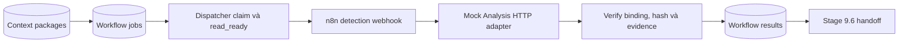
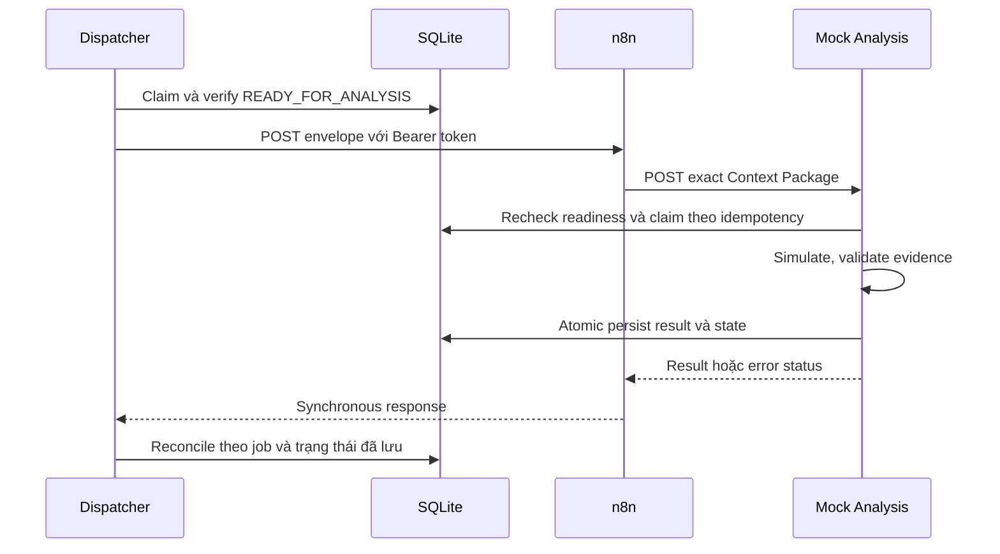
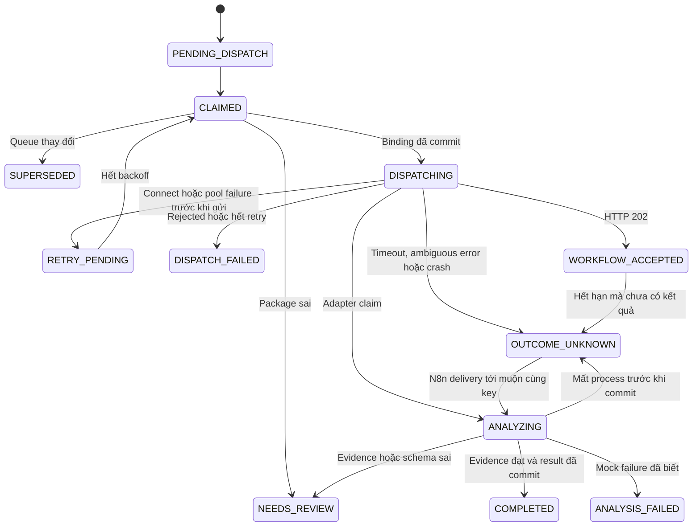

# Stage 9.5 — Automatic n8n workflow integration

Dispatcher chạy độc lập và mặc định tắt. Migration additive trên SQLite Stage 9.4 tạo `workflow_jobs`, `workflow_attempts`, `workflow_results`, status, trigger và handoff view. Trigger chỉ nhận transition sang `READY_FOR_ANALYSIS` sau khi được cài, nên startup không backfill. Monitoring và Context Integration vẫn chạy qua n8n downtime.





## Workspace n8n

Export `workflows/detection-incident.json` dùng một webhook `POST /webhook/detection-incident`, một HTTP Request tới URL nội bộ cố định `http://mock-analysis:8000/analyze/package`, một response node chuyển status/body thật và một response node trả 502 cho transport failure. HTTP Request không retry hoặc follow redirect. Adapter thực hiện auth, validate request và hash, idempotency, phân tích mock, validate evidence và persistence trong cùng ranh giới HTTP. Token Bearer được forward trong header và so sánh constant-time ở adapter. Webhook không tự đánh dấu job hoàn tất chỉ vì nhận được request. n8n cung cấp execution ID qua metadata khi có. Export không chứa credential hoặc Code node. Scenario workflow và Incident Adapter hiện có giữ nguyên. [n8n execution metadata](https://docs.n8n.io/build/code-in-n8n/use-built-in-shortcuts/n8n-metadata.md)

Incident Adapter cũ nhận scenario/trace, tự fetch Context và gọi LLM API theo trace, có SQLite incident riêng và import schema/hàm từ `llm_analysis.py`. `MockProvider` cũ cũng phụ thuộc module LLM. Stage 9.5 dùng mock service riêng không import các module này và chỉ thêm workflow result, chưa tạo incident store hay dashboard mới. [Analysis HTTP contract](ANALYSIS_SERVICE_INTEGRATION_CONTRACT.md)

## Job, snapshot và failure policy



Dispatcher dùng `read_ready(package_id)` và kiểm lại queue, trace/version, eligibility, evidence và digest trong transaction đánh dấu dispatch. Adapter kiểm lại queue tại thời điểm bắt đầu mock. Nếu version mới đến trước thời điểm đó, nó từ chối analysis. Kết quả đã bắt đầu được lưu lịch sử với cờ superseded nếu version mới đã thay thế package. Không có snapshot refetch.

Synchronous workflow giảm số giao thức trạng thái cần đồng bộ. Adapter commit result trước HTTP 200. Sau timeout hoặc mất acknowledgement, dispatcher đối chiếu SQLite theo job. Valid HTTP 200 thiếu kết quả đã commit không tạo success. HTTP 202 chỉ báo accepted và có hạn theo dõi. Chỉ connect/pool failure xác định xảy ra trước khi gửi được retry với backoff 10/20 giây mặc định và cùng key. HTTP auth/schema rejection là terminal. HTTP 5xx hoặc timeout không có trạng thái adapter xác định được ghi `OUTCOME_UNKNOWN`. Lần giao tới muộn có thể hoàn tất cùng key nếu analysis chưa bắt đầu. Một claim đã bắt đầu analysis nhưng mất kết quả không được chạy lại tự động. Stage 9.5 không có callback. Cần đối chiếu theo state/job ID khi điều tra job bất định. Delivery có thể lặp, lưu trữ và replay result idempotent.

SQLite lưu identity Detection/Context/Analysis, correlation key, execution ID nếu có, các mốc dispatch/accept/start/complete, response/hash, validation scope, evidence IDs và attempts có mã lỗi đã sanitize. Context/detection cũ giữ nguyên. `--status` đọc trạng thái derived, queue, in-flight, outcomes, số lần chặn duplicate trong attempt counters, latency từng phase và last success. Job history không bị tự xóa bởi worker.

## Cấu hình và chạy

| Biến sau prefix `WORKFLOW_` | Mặc định |
| --- | --- |
| `DISPATCH_ENABLED`, `DISPATCH_DRY_RUN` | `false`, `false`. Dry-run chỉ đếm ready packages qua SQLite read-only. |
| `N8N_URL`, `WEBHOOK_TOKEN` | URL phải thuộc allowlist `http://workflow-n8n:5678` hoặc `http://127.0.0.1:15678`; token riêng tối thiểu 24 ký tự. Path cố định. |
| `STORAGE_PATH` | `monitoring.sqlite`, dùng cùng SQLite với Context trong stack cô lập. |
| `POLL_INTERVAL_SECONDS`, `BATCH_SIZE`, `MAX_CONCURRENCY` | 5, 16, 2 |
| `TIMEOUT_SECONDS`, `MAX_RETRIES`, `RETRY_BACKOFF_SECONDS` | 25, 2, 10. n8n node timeout 20 giây, mock analysis tối đa 10 giây. |
| `MAX_PAYLOAD_BYTES` | 524288 |
| `ANALYSIS_PROVIDER`, `EXTERNAL_ALLOWED` | `mock`, `false`. Giá trị khác bị từ chối. |

```powershell
$python = "..\thesis-log-anomaly\.venv\Scripts\python.exe"
& $python -B -m tools.check_stage_9_1_integrity
& $python -B -m app.workflow_dispatcher --status
& $python -B -m pytest -q -p no:cacheprovider tests/test_workflow_dispatcher.py tests/test_workflow_integration.py
```

Để smoke test ở Stage 9.7, dùng Compose project mới với SQLite Monitoring/Context riêng và thêm `compose.workflow.yaml` cùng profile `workflow-stage95`. Overlay tạo n8n riêng trên cổng loopback 15678, volume n8n riêng và mạng nội bộ riêng. Cấp `WORKFLOW_N8N_ENCRYPTION_KEY` và `WORKFLOW_WEBHOOK_TOKEN` ngoài Git. Sau khi DB Context được khởi tạo, import `workflows/detection-incident.json` bằng **Import from File** trong editor n8n cô lập, kiểm tra nhánh HTTP/transport, rồi publish workflow để enable production webhook. Bật `WORKFLOW_DISPATCH_ENABLED=true` trước khi đưa fixture mới đến Context readiness. Kiểm tra có đúng một result persisted, hash trùng và cờ mock. Không import vào n8n shared. [n8n workflow import](https://docs.n8n.io/build/manage-workflows/export-and-import.md)

Nếu chạy dispatcher trên host với n8n cô lập, đặt `WORKFLOW_N8N_URL=http://127.0.0.1:15678`, trỏ `WORKFLOW_STORAGE_PATH` đến DB cô lập mà Mock Analysis Service cùng truy cập, cấp token qua môi trường, rồi chạy `& $python -B -m app.workflow_dispatcher`. Dispatcher mặc định không gọi n8n.

Offline tests dùng Elasticsearch mock, FastAPI Hybrid và Context, SQLite tạm và n8n HTTP stub chuyển request tới Mock Analysis FastAPI thật. Kiểm tra tĩnh workflow export dựa trên node versions đang dùng ở repo và các nhánh success/error. Import và thực thi n8n thật, Docker image build và Elasticsearch live ở trạng thái `NOT_TESTED_LIVE`.

Kết quả gồm 40 unit PASS, 13 pipeline PASS, 1 workflow export verification PASS và 204 regression PASS, gồm 197 Stage 9.1–9.4 và 7 scenario adapter tests. Tổng 258 PASS, 0 FAIL, 10 PostgreSQL SKIP vì không cấp DB cô lập, một cảnh báo deprecation từ Starlette. Sáu workflow expressions được thực thi tĩnh với fixture Node.js. Compose `config --quiet` PASS. Gemini, OpenAI và live fault injection bằng 0.
