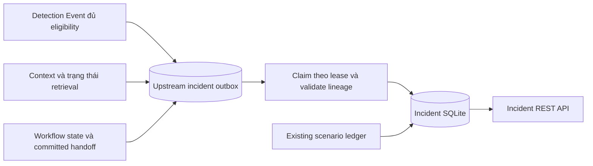
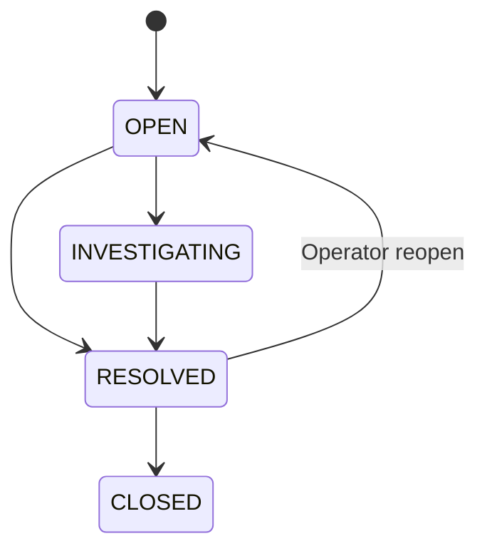

# Stage 9.6 — Incident Management

Stage 9.6 thêm lifecycle và Incident REST API vào cùng SQLite đã dùng bởi Incident Adapter scenario. Logic ledger được tách nguyên vẹn sang `scenario_incident_store.py` để cả hai API đọc cùng dữ liệu. Adapter scenario giữ `POST /trigger`, `GET /incidents/{id}`, auth, idempotency và retention hiện có. Managed API đọc được legacy detail, còn các route mới thao tác trên managed incident. Process quản lý incident không import LLM modules.



## Capture, migration và correlation

Outbox chỉ ghi các Detection Event mới với `ANOMALY + ELIGIBLE` sau khi migration được cài. Nó cũng ghi trạng thái Context/Workflow của lineage đã capture, gồm trường hợp chưa có package hoặc phân tích thất bại. Một anomaly ban đầu `NEEDS_MORE_EVIDENCE` vẫn thuộc review queue upstream; chỉ lần Detection mới có eligibility phù hợp mới tự tạo incident. Với incident đã tạo, Context thiếu evidence hoặc analysis invalid chuyển analysis status sang review. Normal, insufficient, detection error và recovered signal không tự tạo incident.

Source SQLite dùng outbox riêng với stream identity, FIFO, lease và bounded retry. Worker serialize từng handoff để giữ thứ tự. Destination lưu receipt theo source stream và outbox ID trong cùng transaction với incident/revision. Acknowledge ở source sau commit destination. Crash ở giữa có thể replay, và receipt chặn ghi trùng. Hai database không có transaction chung. Khi retry storage hết giới hạn, source giữ row `FAILED`; operator có thể đối chiếu receipt, sửa lỗi storage và chọn replay cùng ID trong môi trường kiểm soát. Worker không tự reset hoặc xóa dữ liệu.

Managed incident identity và correlation key là hai giá trị riêng. Correlation dùng SHA-256 trên canonical JSON array `[source_namespace, trace_id]`, như Stage 9.4. Trace version là số phiên bản nguồn, có thể tăng từ nhiều log trước lần detection đầu tiên. Unique constraints giữ một incident cho mỗi correlation và một detection revision cho mỗi trace version. Context revision giữ package identity, analysis revision giữ job identity, execution ID nếu có và hash response. Kết quả cũ đến muộn được thêm vào lịch sử. Latest state ưu tiên trace version cao hơn. Revisions không thay lifecycle của operator và không tự reopen.

| Bảng destination bổ sung | Vai trò |
| --- | --- |
| `managed_incidents` | Identity, correlation và current projection. |
| `incident_revisions` | Detection, Context và Analysis revisions có source ID và hash. |
| `incident_timeline` | Mốc thực tế và nguồn timestamp, sort theo timestamp rồi row ID. |
| `incident_status_history` | Atomic transition audit với actor và record version. |
| `incident_receipts`, `incident_metrics` | Idempotency, processing outcomes, latency và counts. |

## Lifecycle và bằng chứng



Analysis status độc lập gồm `PENDING`, `ANALYZING`, `ANALYZED`, `NEEDS_REVIEW`, `ANALYSIS_FAILED`, `INSUFFICIENT_EVIDENCE` và `OUTCOME_UNKNOWN`. Operator status chỉ thay đổi qua PATCH với expected record version, reason và credential. Analysis completed không tự resolve incident. Stage 9.6 không có remediation hoặc auto-reopen.

Handoff chỉ đọc workflow result đã commit. Worker kiểm schema, trace/version, detection/package/job identity, correlation, snapshot SHA-256, raw response SHA-256, provider/cờ mock và evidence trên Context package. Hash hoặc metadata sai bị loại, ghi mã lỗi cố định và giữ incident. Evidence phân biệt ID do Detection cung cấp, observation trong Context và observation mock đã validate. Evidence thiếu Context có nhãn unavailable. Timestamp giữ nguồn business/processing/persistence khi có và timeline không sinh mốc giả. Cascade, severity và mock observations không xác nhận root cause hay ảnh hưởng nghiệp vụ. Legacy detail giữ trường proposed cause cũ đúng contract scenario. Contract mock hiện không tạo proposed cause; managed record giữ `null`. Human verification chưa được bật.

## Cấu hình và vận hành

| Biến sau prefix `INCIDENT_` | Default hoặc quy tắc |
| --- | --- |
| `MANAGEMENT_ENABLED`, `HANDOFF_ENABLED` | `false`, `false`. Automatic capture được cài khi bật handoff và các schema upstream đã sẵn sàng. |
| `STORAGE_PATH`, `SOURCE_STORAGE_PATH` | `incidents.sqlite`, source cần khai khi bật handoff. Dùng đúng SQLite scenario của project cô lập. |
| `API_TOKEN`, `READ_TOKEN`, `OPERATOR_ID` | Operator token bắt buộc khi bật API. Reader tùy chọn và phải khác. Operator ID default `internal-operator`. |
| `POLL_INTERVAL_SECONDS`, `BATCH_SIZE` | 5, 32. Worker dùng một claim đang chạy để giữ thứ tự. |
| `MAX_RETRIES`, `RETRY_BACKOFF_SECONDS` | 3, 5 giây, exponential. |
| `MAX_PAGE_SIZE`, `MAX_PAYLOAD_BYTES` | 100, 4096. |

Từ worktree trong PowerShell, đặt hai đường dẫn SQLite đã xác nhận trong môi trường cô lập. Cấp token qua môi trường chạy. Khởi tạo Monitoring, Context và Workflow schemas trước, rồi bật Incident Management trước khi gửi fixture mới cần capture.

```powershell
$python = "..\thesis-log-anomaly\.venv\Scripts\python.exe"
& $python -B -m tools.check_stage_9_1_integrity
$env:INCIDENT_MANAGEMENT_ENABLED = "true"
$env:INCIDENT_HANDOFF_ENABLED = "true"
# Cấp INCIDENT_API_TOKEN, INCIDENT_STORAGE_PATH và INCIDENT_SOURCE_STORAGE_PATH.
& $python -B -m uvicorn app.incident_api:app --host 127.0.0.1 --port 18017 --no-access-log
```

```powershell
& $python -B -m pytest -q -p no:cacheprovider tests/test_incident_management.py tests/test_incident_integration.py tests/test_incident_workflow.py
```

Compose overlay `compose.incident-management.yaml` dùng profile `incident-management`, network nội bộ, cổng loopback 18017, named volume `incident-data` chung với scenario adapter **trong cùng project cô lập** và mount source `monitoring-data`. Không dùng shared database hoặc khởi động shared stack để test. Docker image build, Elasticsearch live và n8n live là `NOT_TESTED_LIVE`. Regression offline bao phủ n8n HTTP stub và Mock Analysis FastAPI thật.

Kết quả thực thi gồm 15 unit/API PASS, 11 pipeline integration PASS và 258 regression PASS. Tổng 284 PASS, 0 FAIL, 10 PostgreSQL SKIP do không cấp DB cô lập và một cảnh báo deprecation từ Starlette. Compose `config --quiet` đạt. Scoped integrity PASS với frozen 8/8, cohort 190/190, acceptance 95/95, MeCoLog 63/63 và 11 historical manifests. Full LLM validator vẫn dừng ở hai digest đã biết; mốc historical 88/88 giữ `HISTORICAL_SCOPE_UNRESOLVED`. Gemini calls, OpenAI calls và live fault injection đều bằng 0.

## Bàn giao

Stage 9.7 có thể tạo smoke fixture trong stack cô lập sau khi cài cả ba outbox migrations. Dùng detail để kiểm OPEN với analysis đang chờ, sau đó kiểm revision, evidence, mock labeling, retry và lifecycle audit. Stage 10.1 dùng list/detail/evidence/timeline/history cho dashboard. Stage 10.2 dùng statistics và time range UTC. [Incident API contract](INCIDENT_API_CONTRACT.md)
